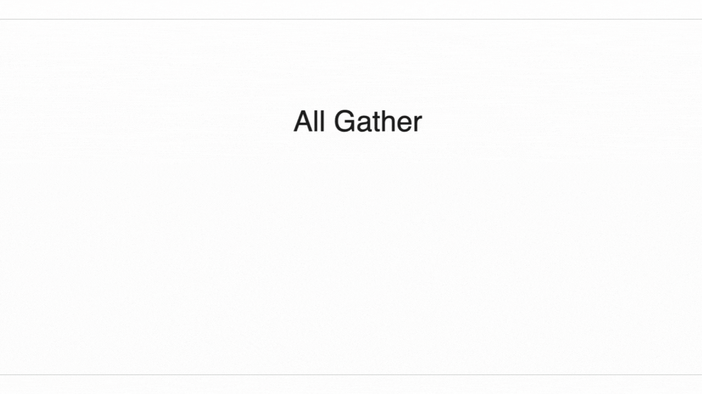
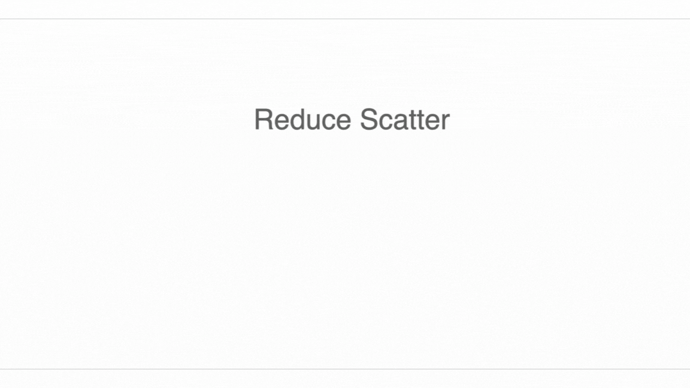

# Collective Operations
## AllGather
- An AllGather removes the sharding along an axis and reassembles the shards spread across devices onto each device along that axis.
$$\textbf{AllGather}_{XY}(A[I_{XY}, J]) \rightarrow A[I, J]$$
- To perform a 1-dimensional AllGather around a single TPU axis, we pass its shard $\lfloor N/2 \rfloor$ hops around a ring until every device has a copy.

- Let $V$ be the number of bytes of the array after gathering, and $N$ be the number of shards. Each shard needs to collect $\frac{N - 1}{N} \times V$ bytes from ingress connections, so the total time needed is $\frac{V \times (N - 1)}{N \times W_{ici}}$, where $W_{ici}$ is the bidirectional ICI bandwidth. When $N$ is large, $T_{comms} \approx \frac{V}{W_{ici}}$ 
- Each hop over an ICI link has some intrinsic overhead regardless of the data volume. This is typically around 1us. This means when our array is very small and each hop takes less than 1us, we can enter a “latency-bound” regime where the calculation does depend on $N$. Let $T_{min}$ be the minimum time for a single hop $T_{total} = max\left[ \frac{T_{min} * N}{2}, \frac{V}{W_{ici}} \right]$

## ReduceScatter
- ReduceScatter sums an unreduced/partially summed array and then scatters shards a different logical axis along the same mesh axis $X[F]\{U_Y\} \rightarrow X[F_Y]$. It's very similar to AllGather, so they roughly have the same latency.

## AllReduce
- AllReduce equals to ReduceScatter + AllGather so its latency is two times of AllGather.
$$AllReduce_Y(A[I_X, J]\{U_Y\}) \rightarrow A[I_X, J_Y] \rightarrow A[I_X, J]$$
$$T_{\text{comms per AllReduce}} = 2 \cdot \frac{V}{W_\text{ici}}$$

## AllToAll
- One can think of an AllToAll as moving a subscript from one axis to another.
$$\textbf{AllToAll}_{X, J} A[I_X, J] \rightarrow A[I, J_X]$$
- Since an all to all doesn’t need to replicate all of the data of each shard across the ring, it’s actually cheaper than an AllGather.

- Consider N-D device mesh AllToAll, data on a single device is $V/N$, where $V$ is the total bytes of an array and $N$ is the total number of devices. Average hops between 2 nodes is $max(device-axis)/4$ so the total bytes that flows through a ICI link is $\frac{V * max(device-axis)}{4 * N}$. We can eventually get the cost of AllToAll:
$$\frac{V * max(device-axis)}{4 * N * W_{ici}}$$

## Relationship Between Operations
- AllReduce equals to ReduceScatter + AllGather
- ReduceScatter and AllGather are derivatives of each other.
$$\textbf{AllGather}_X A[I_X] \rightarrow A[I]$$
$$\textbf{ReduceScatter}_X A'[I] \{ U_X \} \rightarrow A'[I_X]$$