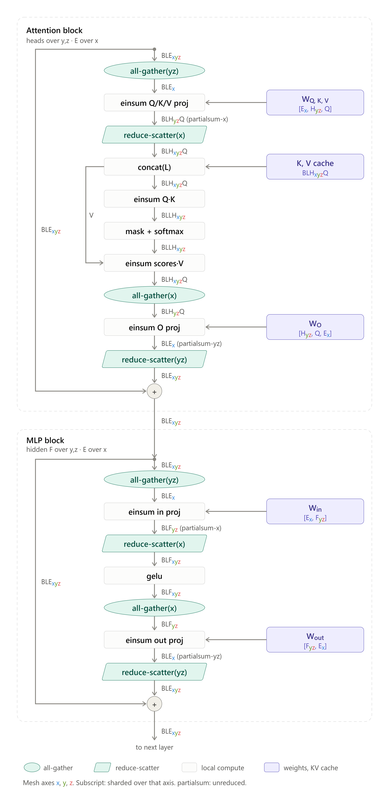
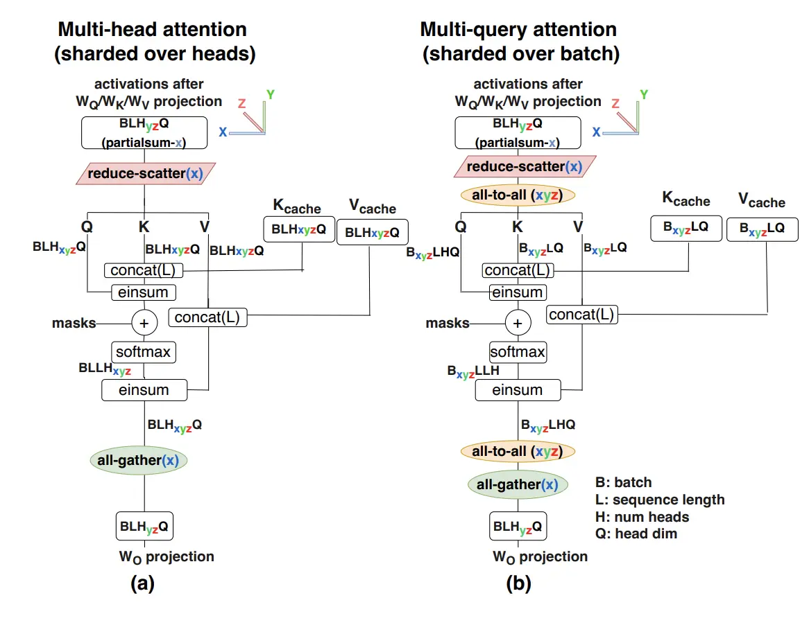
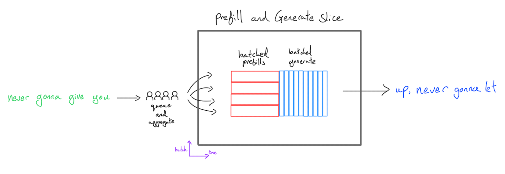
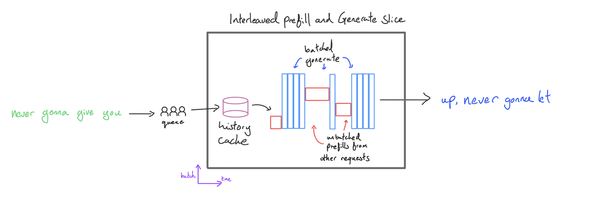
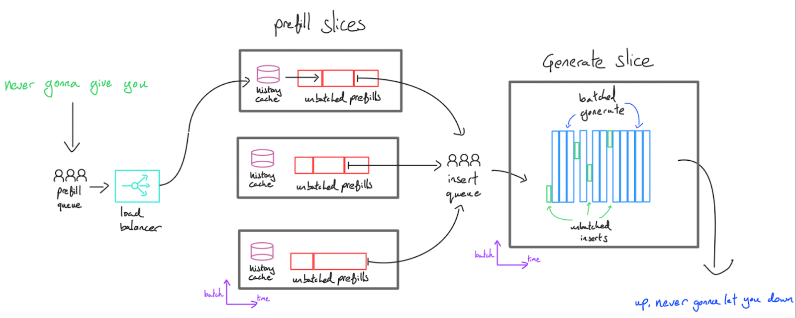
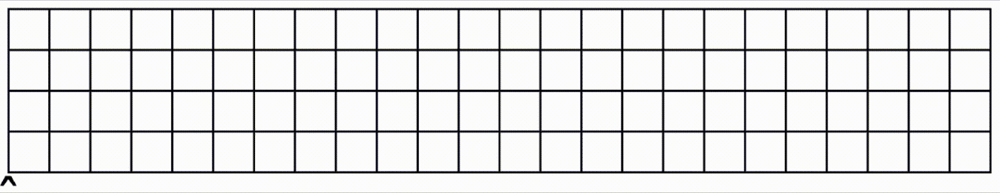
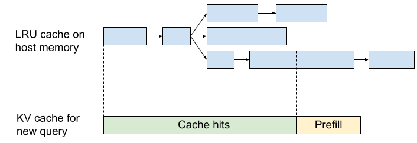

# Inference
## Introduction
- Prefill: Given a long prompt, process all the tokens in the prompt at the same time and save the key value projections in a KV cache. We also save the logits for the last token.
- Generation: Given a KV cache and the previous logits, we incrementally sample one token from the logits, feed that token back into the Transformer, and produce a new set of logits for the next step. We also append the KV activations for that new token to the KV cache and repeat this until we hit a special <EOS> token or reach some maximum length limit.

## Bottleneck Analysis
We need to analyze transoformer operations in both prefill and generation conditions to know operations are compute-bound or memory-bound in each scenario.

### Linear Projection
Consider a single matrix multiply of $bf16[B, D]$ and $bf16[D, F]$. This could be the MLP block or attention projections.

$$\begin{aligned} \frac{2BDF}{2BD + 2DF + 2BF} \approx \frac{2BDF}{2DF} \geq \frac{\text{Accelerator FLOPs/s}}{\text{Bandwidth Bytes/s}} \\ \underset{\text{TPU v5e}}{=} \frac{1.97E+14}{8.20E+11} \implies B \geq 240 = B_{\text{crit}} \end{aligned}$$

If we quantize our weights or use lower precision FLOPs for the matrix multiplication, this critical batch size can change. If we quantize our weights to int8 or fp8, $B _{crit}$ decreases by 2x. If we do our FLOPs in int8 or fp8, $B_{crit}$ increases by 2x. Thus if we let $β = \text{bits per param / bits per activation}$ and $α_{hbm} = C / W_{hbm}$, our critical batch size is actually $B_{crit} = βα_{hbm}$.

Prefill is almost always compute-bound if the prompt is not too short. Generation needs batching to hit $B_{crit}$.

### Attention
1. Read the $Q$ activations of shape $bf16[B, T, D]$ from HBM.
2. Read the $KV$ cache, which is a pair of $bf16[B, S, D]$ tensors from HBM.
3. Perform $2BSTD$ FLOPs in the $QK$ matmul. With Flash Attention, we don’t need to write the $bf16[B, S, T]$ attention matrix back into HBM.
4. Perform $2BSTD$ in the attention $AV$ matmul.
5. Write the resulting $bf16[B, T, D]$ tensor back into HBM.

$$\text{Multiheaded Attention Arithmetic Intensity} = \frac{4BSTD}{4BSD + 4BTD} = \frac{ST}{S+T}$$

For prefill, $S = T$ so it simplifies to $T^2/2T = T/2$. For generation, $S \gg T = 1 \implies \frac{ST}{S+T} \approx 1$. Since $B$ and $D$ are cancelled out, we’re always memory bandwidth-bound during attention.

Conceptually, we’re compute-bound in linear portions of the model because the parameters are **reused** for many batch items. However, every batch item has its own KV cache, so a bigger batch size means more KV caches. This also means you will get diminishing returns on throughput from increasing batch size once KV cache memory becomes comparable to parameter memory of linear projection. That's why the arithmetic intensity doesn't relate to batch size.

### Theoretical estimates for LLM latency and throughput
For small batch sizes **during generation**, we can lower-bound our per-step latency by assuming we’re memory bandwidth bound in both the attention and MLP blocks:

$$\begin{equation*} \text{Theoretical Min Step Time} = \frac{\text{Batch Size} \times \text{KV Cache Size} + \text{Parameter Size}}{\text{Total Memory Bandwidth}} \end{equation*}$$

For throughput, batch size divided by min step time:

$$\begin{equation*} \text{Theoretical Max Tokens/s} = \frac{\text{Batch Size} \times \text{Total Memory Bandwidth}}{\text{Batch Size} \times \text{KV Cache Size} + \text{Parameter Size}} \end{equation*}$$

As our batch size grows, FLOPs begin to dominate parameter loading, so in practice we have the more general equation (this is the most important thing to remember):

$$\begin{align} \tiny \text{Theoretical Step Time (General)} = \underbrace{\frac{\text{Batch Size} \times \text{KV Cache Size}}{\tiny \text{Total Memory Bandwidth}}}_{\text{Attention (always bandwidth-bound)}} + \underbrace{\max\left(\frac{2 \times \text{Batch Size} \times \text{Parameter Count}}{\text{Total FLOPs/s}}, \frac{\text{Parameter Size}}{\text{Total Memory Bandwidth}}\right)}_{\tiny \text{MLP (can be compute-bound)}} \end{align}$$

### Memory
During inference, we don't have optimizer state and checkpoints to store. Activations are too small to consider so we only need to calculate model parameters and KV cache. For LLaMA 2-13B, model weights take 26GB memory and KV cache for a single 8192 sequence at bf16 is
$8192\ (T) \times 40\ (K) \times 128\ (H) \times 40\ (L) \times 2\ (\text{bytes}) \times 2 = 6.7 \text{GB}$

### Tricks for Improving Generation Throughput and Latency
A smaller KV cache makes it easier to increase batch size and context length of the generation step without hurting latency so many techniques have been developed to target the KV cache specifically.
- GQA
- Local Attention Layers: Local attention caps the context to a small to moderately sized max length at training time and prefill time
- Sharing KVs across layers: Share the same KV caches across layers. Whilst this does reduce the KV cache size, and provide benefits in increasing batch size, caching, offline storage, etc., shared KV caches may need to be read from HBM multiple times, so it does not necessarily improve the step time
- Quantization: Inference is usually less sensitive to the precision of parameters and KVs and has the added advantage that even if the model was not trained with quantization it can often be applied post training.
- Using ragged HBM reads and Paged Attention: Requests have a wide range of length distributions and don’t use the max context of the model so it is often not necessary to read the entire KV cache from memory. We can often implement kernels that only read the non-padding part of the KV cache.

## Distributing Inference Over Multiple Accelerators
### Prefill
Prefill is almost identical to training and almost all the same techniques and tradeoffs apply. Generally, do model parallelism up to the ICI bound, then do sequence parallelism.

### Generation
At small batch, generation is HBM-bound. Each step loads all weights and the KV cache from HBM. Sharding must split these loads across chips. Sharding must not move weights over ICI, because ICI is much slower than HBM. **Move activations, not weights.**

| Strategy | Use | Reason |
|---|---|---|
| FSDP | No | It moves weights over ICI. |
| Data parallelism | No | Each replica loads all weights. Step time does not decrease. |
| Query sequence sharding | No | Each request has one query token. The KV cache can still shard along $S$ (see [Sequence](#sequence)). |
| Model sharding | Yes | Each of $N$ chips loads $1/N$ of the weights. HBM time per step decreases $N$ times. |

The cost of model sharding: each layer moves activations over ICI.

#### Megatron Sharding limit
Symbols: $B$ is tokens per step (one per request). $D$ is the model dimension. $F$ is the MLP hidden dimension. $N$ is the number of model-sharded chips. $W_\text{hbm}$ is per-chip HBM bandwidth in bytes/s. $W_\text{ici}$ is per-chip bidirectional ICI bandwidth on one mesh axis, and $r = W_\text{hbm}/W_\text{ici}$ (about 8 for TPU v5e and v6e). Weights and activations are bf16 (2 bytes).

Each mesh axis has its own links. A collective over $k$ axes uses the links of all $k$ axes at the same time, so it runs at $k \cdot W_\text{ici}$.

Training stops model sharding when ICI time exceeds FLOPs time. Generation stops when ICI time exceeds HBM time. For $B < B_\text{crit}$, HBM time is larger than FLOPs time. Thus generation can shard further than training, and latency decreases at a small throughput cost.

With 1D (Megatron) sharding, each chip loads two MLP weight shards of $DF/N$ parameters. Each chip also all-gathers and reduce-scatters a $[B, D]$ activation. Each collective moves about $BD$ elements per chip, for all $N$. On a 3D mesh, both collectives span $xyz$ and run at $3W_\text{ici}$:

$$T_\text{HBM} = \frac{4DF}{N \cdot W_\text{hbm}} \qquad T^\text{1D}_\text{ICI} = \frac{4BD}{3W_\text{ici}}$$
$$T^\text{1D}_\text{ICI} < T_\text{HBM} \iff N < \frac{3F}{B \cdot r}$$

Example: $F = 16384$, $B = 32$ gives $N < 3 \cdot 16384 / (32 \cdot 8) = 192$.

$T_\text{HBM}$ decreases as $1/N$, but $T^\text{1D}_\text{ICI}$ stays constant. 2D sharding makes ICI time also decrease with $N$.

These limits count only weight loads. The KV cache must also shard $N$ ways (see [KV cache sharding](#kv-cache-sharding)).

#### 2D Stationary Sharding Limit
Purpose: decrease ICI time per chip. Then model sharding can use more chips before ICI time exceeds HBM time.

The figure writes $D$ as $E$. $L$ is the query length ($L = 1$ in generation). A subscript gives the mesh axes that shard a dimension. "partialsum" marks an output that still needs a sum over that axis.

[2D weight-stationary sharding](https://arxiv.org/abs/2211.05102) shards each weight on two axes: $D$ over $x$, and the hidden dimension over $y, z$. Each block receives $BLE_{xyz}$ and returns $BLE_{xyz}$. Attention and MLP do the same steps. Attention shards heads $H$ where the MLP shards $F$:

| Step | MLP | Attention |
|---|---|---|
| all-gather($yz$) | $BLE_{xyz} \to BLE_x$ | same |
| einsum 1 | $W_\text{in}[E_x, F_{yz}] \to BLF_{yz}$, partialsum-$x$ | $W_{QKV}[E_x, H_{yz}, Q] \to BLH_{yz}Q$, partialsum-$x$ |
| reduce-scatter($x$) | $\to BLF_{xyz}$ | $\to BLH_{xyz}Q$ |
| local op | gelu (per element) | attention with KV cache $BLH_{xyz}Q$ (per head) |
| all-gather($x$) | $\to BLF_{yz}$ | $\to BLH_{yz}Q$ |
| einsum 2 | $W_\text{out}[F_{yz}, E_x] \to BLE_x$, partialsum-$yz$ | $W_O[H_{yz}, Q, E_x] \to BLE_x$, partialsum-$yz$ |
| reduce-scatter($yz$) | $\to BLE_{xyz}$ | same |

The local op needs no communication, because gelu and attention do not mix the sharded dimension. 1D sharding is the case $|x| = 1$: the $x$ collectives disappear, and the $yz$ collectives become $xyz$ collectives.

#### Why 2D decreases ICI time
Let $X = |x|$, so $|y| \cdot |z| = N/X$. Per chip, the four collectives move:
- all-gather($yz$) and reduce-scatter($yz$): $BD/X$ elements each, at $2W_\text{ici}$ (2 axes).
- reduce-scatter($x$) and all-gather($x$): $BFX/N$ elements each, at $W_\text{ici}$ (1 axis).

$$T^\text{2D}_\text{ICI} = \frac{2B}{W_\text{ici}}\left(\frac{D}{X} + \frac{2FX}{N}\right)$$

The derivative in $X$ is zero at $X = \sqrt{ND/(2F)}$. There, the bracket equals $2\sqrt{2DF/N}$:

$$T^\text{2D}_\text{ICI} = \frac{4B\sqrt{2DF/N}}{W_\text{ici}} < \frac{4DF}{N \cdot W_\text{hbm}} = T_\text{HBM}$$
$$\iff B \cdot r \cdot \sqrt{2DFN} < DF \iff N < \frac{DF}{2B^2r^2}$$

- ICI time now decreases as $1/\sqrt{N}$. Thus the limit moves from $3F/(Br)$ to $DF/(2B^2r^2)$.
- Past this limit, more chips still decrease step time, because ICI time continues to decrease. In 1D, ICI time is a fixed floor on step time ([Scaling Book](https://jax-ml.github.io/scaling-book/inference/), Question 7).
- At large $B$ or in prefill, the step is compute-bound. The same argument applies, with FLOPs time $4BDF/(N \cdot C)$ in place of $T_\text{HBM}$.
- 2D takes less ICI time than 1D when $T^\text{2D}_\text{ICI} < T^\text{1D}_\text{ICI}$:
  $$\frac{4B\sqrt{2DF/N}}{W_\text{ici}} < \frac{4BD}{3W_\text{ici}} \iff 3\sqrt{2DF/N} < D \iff N > \frac{18F}{D}$$
- Example: $D = 8192$, $F = 16384$, $B = 32$ gives $N < 1024$ with $X = 16$. The 1D limit is 192. Thus 2D cuts weight-load time per step 5.3 times more before ICI time dominates. The KV cache must also shard 1024 ways. With $K = 8$ KV heads, heads and batch give only $8 \cdot 32 = 256$ ways, so the other 4 ways need [sequence sharding](#sequence).
- The gain over 1D is $D / (6Br)$. ICI time grows with $B$, so 2D matters most at large batch.

This model has limits. It assumes equal link bandwidth and wraparound on every axis. An axis without wraparound gives about half its bandwidth. It ignores per-hop latency, which dominates at small $B$. It assumes $X$ divides $D$, and $N/X$ divides $F$ and the head count.

#### KV cache sharding
Attention is HBM-bound, and the KV cache load sets its time. If every chip holds a full copy of the cache, every chip loads the full cache, and attention time does not decrease. Thus shard the cache, do not replicate it.

In the figure, $BLH_{xyz}Q$ shards KV heads over all $N$ chips. This needs $K \geq N$, where $K$ is the number of KV heads. GQA models have small $K$ (for example 8). **Shard KV heads as far as possible, then shard the batch over the remaining axes.**

Algorithm for GQA. Mesh axis $Y$ shards heads, and $Z$ shards batch. The projections use 1D sharding. The first AllToAll changes $Q$ from head sharding to batch sharding, so $Q$ matches the cache. The second AllToAll changes $O$ back.
1. $X[B, D] = …$ (existing activations, unsharded from previous layer)
2. $K[B_Z, S, K_Y, H], V[B_Z, S, K_Y, H] = …$ (existing KV cache, batch sharded)
3. $Q[B, N_{YZ}, H] = X[B, D] * W_Q[D, N_{YZ}, H]$
4. $Q[B_Z, N_Y, H] = \text{AllToAll}_{Z->B}(Q[B, N_{YZ}, H])$
5. $Q[B_Z, K_Y, M, H] = \text{Reshape}(Q[B_Z, N_Y, H])$
6. $O[B_Z, S, K_Y, M] = Q[B_Z, K_Y, M, H] *_H K[B_Z, S, K_Y, H]$
7. $O[B_Z, S, K_Y, M] = \text{Softmax}_S(O[B_Z, S, K_Y, M])$
8. $O[B_Z, K_Y, M, H] = O[B_Z, S, K_Y, M] *_S V[B_Z, S, K_Y, H]$
9. $O[B, K_Y, M_Z, H] = \text{AllToAll}_{Z->M}(O[B_Z, K_Y, M, H])$
10. $O[B, N_{YZ}, H] = \text{Reshape}(O[B, K_Y, M_Z, H])$
11. $X[B, D]\{U_{YZ}\} = W_O[N_{YZ}, H, D] *_{N,H} O[B, N_{YZ}, H]$
12. $X[B, D] = \text{AllReduce}(X[B, D]\{U_{YZ}\})$

#### Sequence
If the batch size is too small, or the context is long, we can sequence shard the KV cache. Again, we pay a collective cost in accumulating the attention across shards here. First we need to AllGather the Q activations, and then accumulate the KVs in a similar fashion to Flash Attention.

## Design Efficient Inference Engine
The most naive design, we batch both prefill and generation.

- Latency is terrible when the prefill batch size is big
- Shorter generations are blocked by the longer one
- Padded prefill wastes FLOPs
- We can't have different topologies for prefill and generation.

We can improve the design by interleaving a single prefill with a batch generations.

By prioritizing prefill job, we can still have high utilization even if the batch size of generation is big. We can also prevent prefill padding. The main disadvantage is that when the server is performing a prefill, the generation of all other requests pauses since all the compute resources will be consumed by the prefill.

To get around this, we separate decode and prefill on two different set of TPUs/GPUs. Prefill servers generate KV caches that get sent across the network to the generate servers, which batch multiple caches together and generate tokens for each of them. We call this “disaggregated” serving.

- A user’s request never blocks on another user’s, except if there is insufficient prefill capacity. We can scale the number of prefill servers independently.
- Two different workload require two different sharding strategies and disaggregation allows generation to use larger model parallelism.

### Continuous batching

We optimize and compile:

- A prefill function that handles variable context lengths and inserts results into a KV buffer with some maximum batch size and context length/number of pages.
- A generate function which takes in the KV cache, and performs the generation step for all currently active requests.

We then combine these functions with an orchestrator which queues the incoming requests, calls prefill and generate depending on the available generate slots,

### Prefix caching
Cache the KV of the prefix of the prompt. The only reason this is hard to do is memory constraints.
- The KV cache is local to the set of TPUs that handled the initial request, we need some form of affinity routing to ensure follow-up queries arrive at the same replica. This can cause issues with load balancing.
- A smaller KV cache is helpful — it enables us to save more KV caches in the same amount of space, and reduce read times.
- The KV cache and their lookups can be stored quite naturally in a tree or trie. Evictions can happen on an LRU basis.
