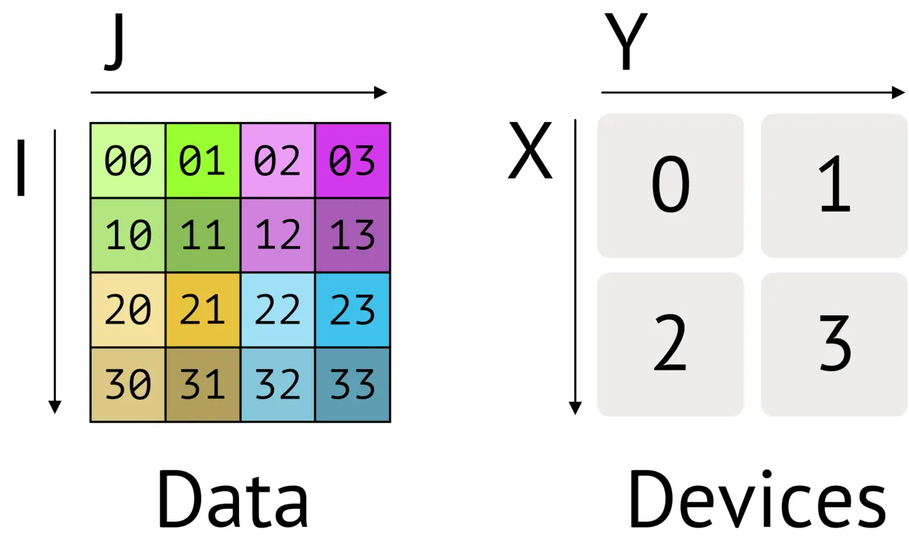
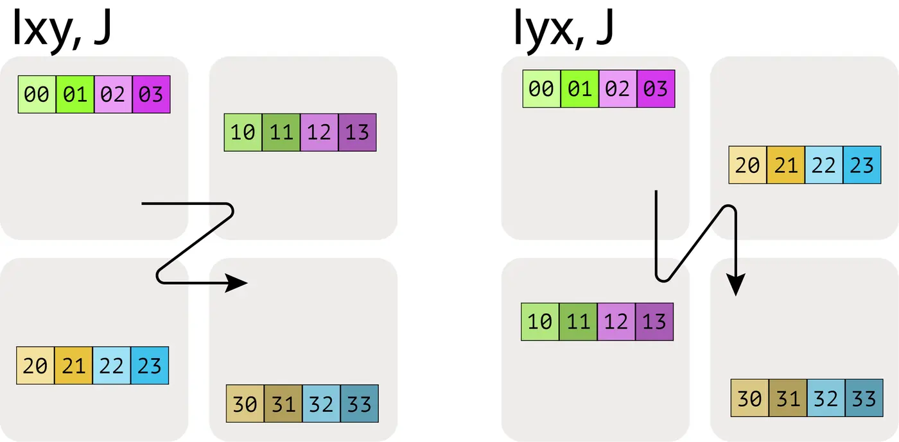

# Multiply Shared Matrices

## Notations

- Mesh: the device mesh Mesh(devices=((0, 1), (2, 3)), axis_names=('X', 'Y')) tells us we have 4 TPUs in a 2x2 grid, with axis names $X$ and $Y$.
- Sharding: $A[I_X, J_Y]$, which tells us to shard the first axis, $I$, along the mesh axis $X$, and the second axis, $J$, along the mesh axis $Y$. This sharding tells us that each shard holds $1/(|X| \cdot |Y|)$ of the array.
- The order of the multiple mesh-axis subscripts matters, as it specifies the traversal order of the partitioning across the grid.

- We cannot have multiple named axes sharded along the same mesh dimension. e.g. $A[I_X, J_X]$ is a nonsensical, forbidden sharding. Once a mesh dimension has been used to shard one dimension of an array, it is in a sense “spent”.

## Computation of Sharded Arrays
- Matrix multiplication has the nice property that when the matrix multiplicands are written in terms of blocks, the product can be written in terms of block matmuls following the standard rule:
$\begin{equation} \begin{pmatrix} a_{00} & a_{01} & a_{02} & a_{03} \\ a_{10} & a_{11} & a_{12} & a_{13} \\ a_{20} & a_{21} & a_{22} & a_{23} \\ a_{30} & a_{31} & a_{32} & a_{33} \end{pmatrix} = \left( \begin{matrix} \begin{bmatrix} a_{00} & a_{01} \\ a_{10} & a_{11} \end{bmatrix} \\ \begin{bmatrix} a_{20} & a_{21} \\ a_{30} & a_{31} \end{bmatrix} \end{matrix} \begin{matrix} \begin{bmatrix} a_{02} & a_{03} \\ a_{12} & a_{13} \end{bmatrix} \\ \begin{bmatrix} a_{22} & a_{23} \\ a_{32} & a_{33} \end{bmatrix} \end{matrix} \right) = \begin{pmatrix} \mathbf{A_{00}} & \mathbf{A_{01}} \\ \mathbf{A_{10}} & \mathbf{A_{11}} \end{pmatrix} \end{equation}$
$\begin{equation} \begin{pmatrix} A_{00} & A_{01} \\ A_{10} & A_{11} \end{pmatrix} \cdot \begin{pmatrix} B_{00} & B_{01} \\ B_{10} & B_{11} \end{pmatrix} = \begin{pmatrix} A_{00}B_{00} + A_{01}B_{10} & A_{00}B_{01} + A_{01}B_{11} \\ A_{10}B_{00} + A_{11}B_{10} & A_{10}B_{01} + A_{11}B_{11} \end{pmatrix} \end{equation}$
What this means is that implementing distributed matrix multiplications reduces down to moving these sharded blocks over the network, performing local matrix multiplications on the blocks, and summing their results. The question then is what communication to add, and how expensive it is.
- Case 1: neither multiplicand has a sharded contracting dimension. When multiplying sharded matrices, the computation is valid and the output follows the sharding of the inputs unless the contracting dimension is sharded or both matrices are sharded along the same axis. Any of these cases work fine and follow this rule:
$$
\begin{aligned}
\mathbf{A}[I, J] \cdot \mathbf{B}[J, K]
&\rightarrow \mathbf{C}[I, K] \\
\mathbf{A}[I_X, J] \cdot \mathbf{B}[J, K]
&\rightarrow \mathbf{C}[I_X, K] \\
\mathbf{A}[I, J] \cdot \mathbf{B}[J, K_Y]
&\rightarrow \mathbf{C}[I, K_Y] \\
\mathbf{A}[I_X, J] \cdot \mathbf{B}[J, K_Y]
&\rightarrow \mathbf{C}[I_X, K_Y]
\end{aligned}
$$
- Case 2: one multiplicand has a sharded contracting dimension. When multiplying matrices where one of the matrices is sharded along the contracting dimension, we generally AllGather it first so the contraction is no longer sharded, then do a local matmul.
$$\textbf{AllGather}_X[I, J_X] \rightarrow \mathbf{A}[I, J]$$
$$\mathbf{A}[I, J] \cdot \mathbf{B}[J, K] \rightarrow \mathbf{C}[I, K]$$
- Case 3: both multiplicands have sharded contracting dimensions. When both multiplicands are sharded on their contracting dimensions, along the same mesh axis: $$\textbf{A}[I, J_X] \cdot_\text{LOCAL} \textbf{B}[J_X, K] \rightarrow C[I, K] \{\ U_X \}$$
The syntax means we perform the local sum but leave the result unreduced. AllReduce removes partial sums, resulting in each device along the axis having the same fully-summed value.
$$\textbf{AllReduce}_Y A[I_X, J] \{U_Y\} \rightarrow A[I_X, J]$$
- Case 4: both multiplicands have a non-contracting dimension sharded along the same axis. $A[I_X, J] \cdot B[J, K_X] \rightarrow C[I_X, K_X]$ is invalid because a given shard, say i, along dimension X, would have the (i, i)th shard of C, that is, a diagonal entry. There is not enough information among all shards to recover anything but the diagonal entries of the result. We need to perform AllGather some dimensions:
$$\begin{align*} \textbf{AllGather}_X A[I_X, J] \rightarrow &\ A[I, J] \\ A[I, J] \cdot B[J, K_X] \rightarrow &\ C[I, K_X] \end{align*}$$