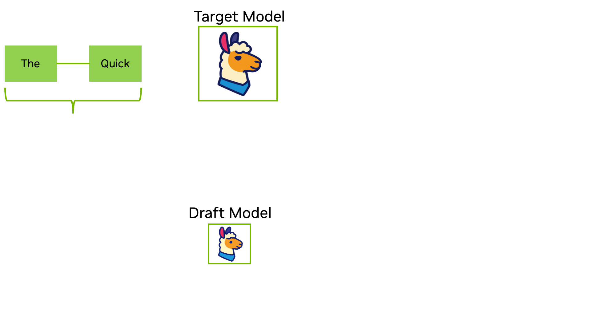
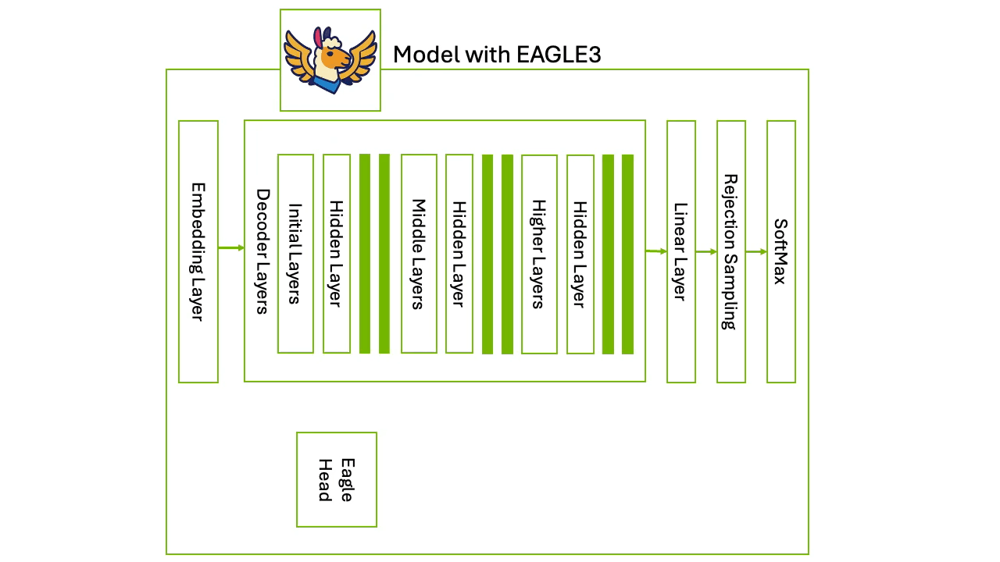

# Speculative Decoding

## The problem

Autoregressive decode is memory-bandwidth bound. Every token requires reading the entire weight matrix from HBM, and at batch 1 those weights are used for a single token's worth of arithmetic.

A 70B model in BF16 on one H100:

| Quantity | Value |
| --- | --- |
| Weights to read per token | 140 GB |
| HBM bandwidth | 3.35 TB/s |
| Time floor per token | 42 ms → ~24 tok/s |
| FLOPs per token (2·params) | 140 GFLOP |
| Time at peak BF16 (989 TFLOP/s) | 0.14 ms |

Arithmetic intensity is 1 FLOP/byte. The machine balances at 989/3.35 ≈ **295 FLOP/byte**. Decode runs at ~1/300 of the GPU's compute, and the 42 ms is spent waiting on memory. Making the model faster at arithmetic changes nothing; the only lever is getting more tokens out of each weight read.

## The idea

Two models: a cheap **draft** that proposes and an expensive **target** that checks.

1. Draft generates K tokens sequentially.
2. Target runs **one** forward pass over all K proposals at once, scoring each position against the prefix that precedes it.
3. Accept the longest verified prefix; discard the rest and evict their KV cache entries ([SGLang notes](https://github.com/zhaochenyang20/Awesome-ML-SYS-Tutorial/blob/main/sglang/speculative-decoding/speculative-decoding.md)).



*Draft proposes, target accepts the longest verified prefix. Figure from [NVIDIA's introduction to speculative decoding](https://developer.nvidia.com/blog/an-introduction-to-speculative-decoding-for-reducing-latency-in-ai-inference/).*

### Why verification is nearly free

The K proposals go through the target as one batch of K positions. The weight read — the 140 GB — happens once regardless of K. FLOPs scale with K, so intensity rises from 1 to K FLOP/byte, still two orders of magnitude below the 295 the hardware needs. Verifying 4 tokens costs almost exactly what verifying 1 costs.

That asymmetry is the whole technique: sequential work moves onto a model whose weight read is small, and the expensive read is amortized over K tokens.

### Keeping the output distribution exact

Draft proposes `x ~ q(x)`; target gives `p(x)`.

- Accept `x` with probability `min(1, p(x)/q(x))`.
- On rejection, sample the replacement from the normalized residual `max(0, p(x) - q(x))` and end the cycle.

The result is distributed exactly as `p` ([Leviathan et al.](https://arxiv.org/abs/2211.17192), [Chen et al.](https://arxiv.org/abs/2302.01318)). No approximation, no quality knob — the draft model's quality affects speed only.

Two precision notes on the [NVIDIA introduction](https://developer.nvidia.com/blog/an-introduction-to-speculative-decoding-for-reducing-latency-in-ai-inference/), which describes acceptance as a deterministic `P(target) ≥ P(draft)` test producing output "identical" to the target's:

- That deterministic test is the **greedy** special case (accept iff the draft token is the target's argmax). Under sampling the rule is probabilistic, per above.
- Greedy gives token-identical output. Sampling gives equality **in distribution**, not per-sample — the same seed will not reproduce the non-speculative sequence.

### Expected tokens per cycle

Model each draft token as accepted independently with probability α. Let `N` be how many are accepted before the first rejection, capped at K.

A cycle emits `N + 1` tokens, not `N`. The extra one is free either way:

- **Rejection at position N+1.** The residual resample (above) produces a token from `p`. The draft tokens after it are discarded — one rejection ends the cycle, since everything downstream was conditioned on a token that did not survive.
- **All K accepted.** The verify pass scored position K+1 as well, so `p` at that position is already computed. Sample it.

Now count by position rather than by outcome. Token `i+1` of the cycle is emitted exactly when the first `i` draft tokens were all accepted — probability `α^i`. Summing those probabilities gives the expectation:

```
E = Σ(i=0..K) α^i = (1 - α^(K+1)) / (1 - α)
```

the geometric series ([Leviathan et al. §3](https://arxiv.org/abs/2211.17192), where draft length is γ).

The `i = 0` term is `α^0 = 1`: every cycle emits at least one token even when the draft is rejected outright. That is the floor — speculative decoding degrades to plain decode, never below it, in token count per target pass.

| α \ K | 2 | 4 | 7 | K → ∞ |
| --- | --- | --- | --- | --- |
| 0.6 | 1.96 | 2.31 | 2.46 | 2.5 |
| 0.8 | 2.44 | 3.36 | 4.16 | 5.0 |
| 0.9 | 2.71 | 4.10 | 5.70 | 10.0 |

The last column is the `K → ∞` limit, `1/(1-α)`. Acceptance rate caps the speedup no matter how long the draft runs: at α = 0.6 no draft length beats 2.5 tokens per target pass, and K=7 is already at 2.46 of it. Returns flatten because token `i+1` requires surviving `i` consecutive coin flips. The useful K is set by α, not by how many tokens the draft can produce.

**Where the model is optimistic.** α is treated as constant and independent across positions. In practice it decays with position — draft token 5 is conditioned on four tokens the draft itself invented, so it drifts from the target's distribution — which makes the true curve flatten faster than the table. The formula also assumes a single chain; tree drafting changes the counting, since several candidates share position i+1.

End to end with a 1B BF16 draft (2 GB read per step, 1.4% of a target pass), α = 0.8, K = 4:

```
3.36 tokens / (1 + 4 × 0.014) target-passes ≈ 3.2x
```

Reported gains land lower — roughly 1.5–3x at small batch — because kernel launches, the draft's attention and sampling, and the verify pass's extra positions are not free.

### Where drafts come from

| Source | Mechanism | Trade |
| --- | --- | --- |
| Separate small model | Distilled or smaller sibling of the target | Simple; extra weights in memory; α depends on how well the pair aligns |
| [EAGLE](https://arxiv.org/abs/2401.15077) / [-2](https://arxiv.org/abs/2406.16858) / [-3](https://arxiv.org/abs/2503.01840) | Light head drafts at the target's *feature* level, reusing its hidden states | High α for a small head; must be trained against that specific target |
| [Medusa](https://arxiv.org/abs/2401.10774) | Several extra decoding heads predict positions t+1…t+k in parallel | No sequential draft loop; its typical-acceptance mode does **not** preserve the target distribution |

Tree drafting (EAGLE-2 onward, and the dynamic draft tree the NVIDIA post attributes to EAGLE-3) replaces the single K-chain with a branching candidate tree verified in one pass under a tree attention mask. More positions verified per call, higher chance a long path survives.



*EAGLE-3 drafts from the target's own hidden states across several depths, which is why the head is cheap and why it is tied to one target. Figure from [NVIDIA's introduction to speculative decoding](https://developer.nvidia.com/blog/an-introduction-to-speculative-decoding-for-reducing-latency-in-ai-inference/).*

## The cost

- **Compute spent on rejected tokens.** Every discarded draft token consumed a draft forward pass and a verified position. Acceptable only because decode has compute to waste — which makes the next point the binding one.
- **It dies at large batch.** Batching restores arithmetic intensity: around 300 concurrent sequences the target's decode is already compute-bound, and the wasted FLOPs on rejected tokens come straight out of throughput. Speculative decoding buys **latency at low concurrency** and can go net-negative on a saturated serving node. Serving stacks gate it on batch size for this reason.
- **α is workload-dependent and not knowable in advance.** Boilerplate code drafts well; dense reasoning does not. The same deployment can see 0.9 and 0.5 on different requests, which is why K is tuned per workload or adapted online.
- **Memory and operational weight.** A separate draft holds its own weights and KV cache; EAGLE and Medusa heads must be trained per target, so every target upgrade re-opens that work.
- **Rollback complexity.** Rejected positions' KV entries must be evicted correctly. This interacts with paged KV, prefix sharing, and chunked prefill — an implementation cost paid once, but paid in the hottest part of the serving loop.
