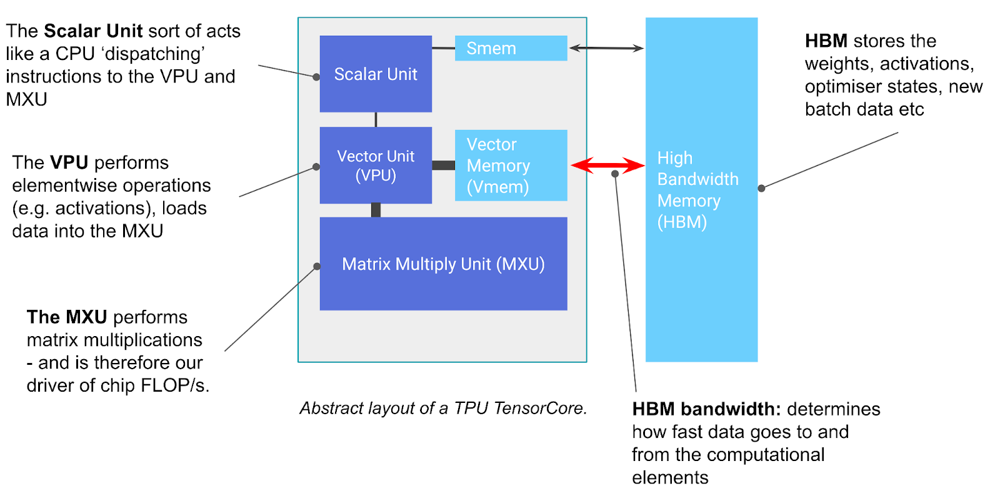
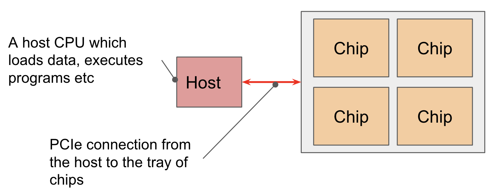

# TPU
- A TPU is a compute core that specializes in matrix multiplication, TensorCore, attached to a stack of fast memory, HBM.

- Most TensorCores have 2 or 4 MXUs
- TPUs support lower precision matmuls with higher throughput
- VMEM is much smaller than HBM but has a much higher bandwidth to the MXU. VMEM operates somewhat like an L1/L2 cache on CPUs but is much larger and programmer-controlled. Data in HBM needs to be copied into VMEM before the TensorCore can do any computation with it.
- All TPU operations are pipelined and overlapped.

- If an algorithm can fit all its inputs/outputs in VMEM, it’s much less likely to hit communication bottlenecks. This is particularly helpful when a computation has poor arithmetic intensity: VMEM bandwidth is around 22x higher than HBM bandwidth which means an MXU operation reading from/writing to VMEM requires an arithmetic intensity of only 10-20 to achieve peak FLOPs utilization.
- A TPU chip typically (but not always) consists of two TPU cores which share memory and can be thought of as one large accelerator. Chips are arranged in sets of 4 on a ‘tray’ connected to a CPU host via PCIe network (16GB/s, 100x slower than HBM). This is the format most people will be familiar with, 4 chips (8 cores, though usually treated as 4 logical megacores) exposed through Colab or a single TPU-VM.

- Chips are connected to each other through the ICI network in a Pod. ICI (“inter-chip interconnects”) connects the 4 nearest neighbors (with edge links to form a 2D torus) or the nearest 6 neighbors (forming a 3D torus). Note these connections do not go through their hosts, they are direct links between chips. The toroidal structure reduces the maximum distance between any two nodes from $N$ to $N /\ 2$

- Nearest-neighbor connectivity is a key difference between TPUs and GPUs. GPUs are connected with a hierarchy of switches that approximate a point-to-point connection between every GPU, rather than using local connections like a TPU. Typically, GPUs within a node are directly connected, while larger topologies require O(log(N)) hops between each GPU. On the one hand, that means GPUs can send arbitrary data within a small number of hops. On the other hand, TPUs are dramatically cheaper, simpler to wire together, and can scale to much larger topologies because the number of links per device and the bandwidth per device is constant.