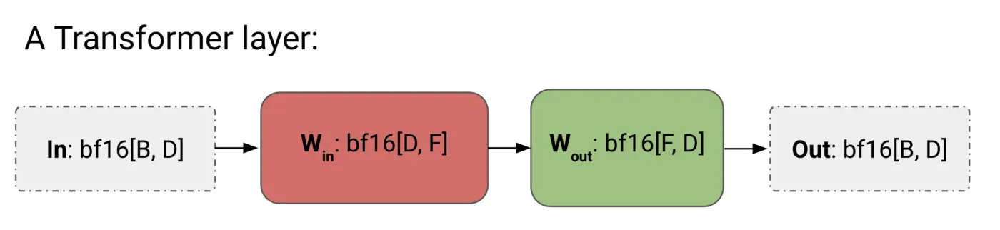
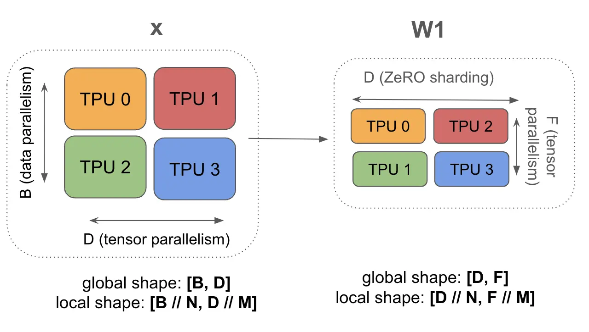

# Training
## Introduction
We discuss four main parallelism schemes and calculate at what point we become bottlenecked by communication.

## Notation
| Notation | Meaning (model parameters) |
|----------|----------------------------|
| D | $d_{model}$ (the hidden dimension/residual stream dim) |
| F | $d_{ff}$ (the feed-forward dimension) |
| B | Batch dimension (number of tokens in the batch; total, not per-device) |
| T | Sequence length |
| L | Number of layers in the model |

| Notation | Meaning (hardware characteristic) |
|----------|-----------------------------------|
| C | FLOPS/s per chip |
| W | Network bandwidth (bidirectional, often subscripted as e.g. $W_{\text{ici}}$ or $W_{\text{dcn}}$) |
| X | Number of chips along mesh axis X |
| Y | Number of chips along an alternate mesh axis, labeled Y |
| Z | Number of chips along a third mesh axis, labeled Z |

Notes for notations:
- $B$ is the total batch tokens. As far as the MLP is concerned, it doesn’t matter if they belong to the same sequence or two different sequences.
- Using $M$ axes provides ($\approx M$ times) aggregate link bandwidth, so collective time scales $\propto 1 / M$

## Assumption
We approximate a Transformer as a stack of MLP blocks, attention is a comparatively small fraction of the FLOPs for larger models, and also ignore the gating matmul.

## Parallel Schemes
### Data Parallelism
Activations sharded along batch, parameters and optimizer state are replicated on each device. Communication only occurs during the backwards pass. $$\text{In}[B_X, D] \cdot_D W_\text{in}[D, F] \cdot_F W_\text{out}[F, D] \rightarrow \text{Out}[B_X, D]$$ When a model fits on a single chip with even a tiny batch size >240 tokens, you should always use simple data parallelism. Pure data parallelism splits our activations across any number of TPUs. The forward pass involves no communication, but at the end of every step, each TPU performs an AllReduce on its local gradients to synchronize them before updating the parameters.
> **Pure Data Parallelism Algorithm:**
>
> **Forward pass:** need to compute $\text{Loss}[B_X]$
>
> 1. $\text{Tmp}[B_X, F] = \text{In}[B_X, D] *_D W_\text{in}[D, F]$
> 2. $\text{Out}[B_X, D] = \text{Tmp}[B_X, F] *_F W_\text{out}[F, D]$
> 3. $\text{Loss}[B_X] = \dots$
>
> **Backward pass:** need to compute $dW_\text{out}[F, D]$, $dW_\text{in}[D, F]$
>
> 1. $d\text{Out}[B_X, D] = \dots$
> 2. $dW_\text{out}[F, D]\ \{U_X\} = \text{Tmp}[B_X, F] *_B d\text{Out}[B_X, D]$
> 3. $dW_\text{out}[F, D] = \textbf{AllReduce}(dW_\text{out}[F, D]\ \{U_X\})$ *(not on critical path, can be done async)*
> 4. $d\text{Tmp}[B_X, F] = d\text{Out}[B_X, D] *_D W_\text{out}[F, D]$
> 5. $dW_\text{in}[D, F]\ \{U_X\} = \text{In}[B_X, D] *_B d\text{Tmp}[B_X, F]$
> 6. $dW_\text{in}[D, F] = \textbf{AllReduce}(dW_\text{in}[D, F]\ \{U_X\})$ *(not on critical path, can be done async)*
> 7. $d\text{In}[B_X, D] = d\text{Tmp}[B_X, F] *_F W_\text{in}[D, F]$ *(needed for previous layers)*

**When to do this?** Pure data parallelism reduces activation memory pressure by splitting our activations over the batch dimension, it's very helpful during training when our activations often dominate our memory usage.

**When not to do this?** Pure data parallelism is rarely useful for interesting models at scale where our parameters + optimizer state don’t fit in a single TPU. If we train with parameters in bf16 and optimizer state in fp32 with Adam2, the largest model we can fit has $\text{TPU memory} / 10$ so on a TPUv5p chip with 96GB of HBM and pure data parallelism this is about 9B parameters.

**When is it communication-bound?** \
Communication: For each layer, there are two matrices of size $2DF$ needs AllReduce and each AllReduce cost $\frac{2 \times total bytes}{W_{ici}}$. The total communication time of a layer is $\begin{align} T_\text{comms} &= \frac{2 \cdot 2 \cdot 2 \cdot D \cdot F}{W_\text{ici}}. \\ \end{align}$
Compute: Each layer comprises two matmuls in the forward pass, or four matmuls in the backwards pass, each of which requires $2(B / X)DF$ FLOPs. Thus, for a single layer in the backward pass, we have $\begin{align} T_\text{math} &= \frac{2 \cdot 2 \cdot 2 \cdot B \cdot D \cdot F}{X \cdot C} \\ \end{align}$

We become compute-bound when:
$\begin{align} \frac{B}{X} > \frac{C}{W_\text{ici}}. \end{align}$ or more generally, where $M_X$ is the number of mesh axes $\begin{align} \frac{B}{M_X} > \frac{C}{W_\text{ici}}. \end{align}$

### Fully-sharded data parallelism
Activations sharded along batch, parameters sharded along same mesh axis and AllGathered just-in-time before use in forward pass. Optimizer state also sharded along batch. $$\text{In}[B_X, D] \cdot_D W_\text{in}[D_X, F] \cdot_F W_\text{out}[F, D_X] \rightarrow \text{Out}[B_X, D]$$ Compared to pure data parallelism, FSDP drastically reduces per-device memory usage and saves on backward pass FLOPs, with very minimal overhead.
> **Forward pass:** need to compute $\text{Loss}[B_X]$
>
> 1. $W_\text{in}[D, F] = \textbf{AllGather}(W_\text{in}[D_X, F])$ *(not on critical path, can do it during previous layer)*
> 2. $\text{Tmp}[B_X, F] = \text{In}[B_X, D] \ast_D W_\text{in}[D, F]$ *(can throw away $W_\text{in}[D, F]$ now)*
> 3. $W_\text{out}[F, D] = \textbf{AllGather}(W_\text{out}[F, D_X])$ *(not on critical path, can do it during previous layer)*
> 4. $\text{Out}[B_X, D] = \text{Tmp}[B_X, F] \ast_F W_\text{out}[F, D]$
> 5. $\text{Loss}[B_X] = \dots$
>
> **Backward pass:** need to compute $dW_\text{out}[F, D_X]$, $dW_\text{in}[D_X, F]$
>
> 1. $d\text{Out}[B_X, D] = \dots$
> 2. $dW_\text{out}[F, D]\ \{U_X\} = \text{Tmp}[B_X, F] \ast_B d\text{Out}[B_X, D]$
> 3. $dW_\text{out}[F, D_X] = \textbf{ReduceScatter}(dW_\text{out}[F, D]\ \{U_X\})$ *(optimizer is sharded, not on critical path, can be done async)*
> 4. $W_\text{out}[F, D] = \textbf{AllGather}(W_\text{out}[F, D_X])$ *(can be done ahead of time)*
> 5. $d\text{Tmp}[B_X, F] = d\text{Out}[B_X, D] \ast_D W_\text{out}[F, D]$ *(can throw away $W_\text{out}[F, D]$ here)*
> 6. $dW_\text{in}[D, F]\ \{U_X\} = \text{In}[B_X, D] \ast_B d\text{Tmp}[B_X, F]$
> 7. $dW_\text{in}[D_X, F] = \textbf{ReduceScatter}(dW_\text{in}[D, F]\ \{U_X\})$ *(not on critical path, can be done async)*
> 8. $W_\text{in}[D, F] = \textbf{AllGather}(W_\text{in}[D_X, F])$ *(can be done ahead of time)*
> 9. $d\text{In}[B_X, D] = d\text{Tmp}[B_X, F] \ast_F W_\text{in}[D, F]$ *(needed for previous layers)* *(can throw away $W_\text{in}[D, F]$ here)*

**When to do this?** Standard data parallelism involves a lot of duplicated work. All TPUs do the same work. AllReduces the full gradient, updates the full optimizer state, then updates the parameters.

**When is it communication-bound?** Here we model the forward pass since it has the same FLOPs-to-comms ratio as the backward pass:
$$\begin{aligned} T_\text{math} &= \frac{2 \cdot 2 \cdot B \cdot D \cdot F}{X \cdot C} \\ T_\text{comms} &= \frac{2 \cdot 2 \cdot D \cdot F}{W_\text{ici}} \\ T &\approx \max\left(\frac{4 \cdot B \cdot D \cdot F}{X \cdot C}, \frac{4 \cdot D \cdot F}{W_\text{ici}}\right) \\ T &\approx 4 \cdot D \cdot F \cdot \max\left(\frac{B}{X \cdot C}, \frac{1}{W_\text{ici}}\right) \end{aligned}$$
As with pure data-parallelism, we are compute bound when $B / X > C / W_{ici}$ It means if our per-device batch size is big enough to be compute-bound for pure data-parallelism, we can, without worrying about leaving the compute-bound regime, simply upgrade to FSDP

### Tensor parallelism
Also called model parallelism: activations sharded along D, parameters sharded along F. AllGather and ReduceScatter activations before and after each block. Compatible with FSDP. $$\text{In}[B, D_Y] \cdot_D W_\text{in}[D, F_Y] \cdot_F W_\text{out}[F_Y, D] \rightarrow \text{Out}[B, D_Y]$$ **Tensor Parallelism is only cheaper when when the activations $B \times D$ are smaller than the weights $D \times F$.** If only the $Y$ axis is used, every device processes the full global batch $B$ in tokens, often millions. $F$ is typically only tens of thousands, so we often mix it with FSDP to make $B$ smaller.
> **Forward pass:** need to compute $\text{Loss}[B]$
>
> 1. $\text{In}[B, D] = \textbf{AllGather}(\text{In}[B, D_Y])$ *(on critical path)*
> 2. $\text{Tmp}[B, F_Y] = \text{In}[B, D] \ast_D W_\text{in}[D, F_Y]$ *(not sharded along contracting, so no comms)*
> 3. $\text{Out}[B, D]\ \{U_Y\} = \text{Tmp}[B, F_Y] \ast_F W_\text{out}[F_Y, D]$
> 4. $\text{Out}[B, D_Y] = \textbf{ReduceScatter}(\text{Out}[B, D]\ \{U_Y\})$ *(on critical path)*
> 5. $\text{Loss}[B] = \dots$
>
> **Backward pass:** need to compute $dW_\text{out}[F_Y, D]$, $dW_\text{in}[D, F_Y]$
>
> 1. $d\text{Out}[B, D_Y] = \dots$
> 2. $d\text{Out}[B, D] = \textbf{AllGather}(d\text{Out}[B, D_Y])$ *(on critical path)*
> 3. $dW_\text{out}[F_Y, D] = \text{Tmp}[B, F_Y] \ast_B d\text{Out}[B, D]$
> 4. $d\text{Tmp}[B, F_Y] = d\text{Out}[B, D] \ast_D W_\text{out}[F_Y, D]$ *(can throw away $d\text{Out}[B, D]$ here)*
> 5. $\text{In}[B, D] = \textbf{AllGather}(\text{In}[B, D_Y])$ *(this can be skipped by sharing with (1) from the forward pass)*
> 6. $dW_\text{in}[D, F_Y] = \text{In}[B, D] \ast_B d\text{Tmp}[B, F_Y]$
> 7. $d\text{In}[B, D]\ \{U_Y\} = d\text{Tmp}[B, F_Y] \ast_F W_\text{in}[D, F_Y]$ *(needed for previous layers)*
> 8. $d\text{In}[B, D_Y] = \textbf{ReduceScatter}(d\text{In}[B, D]\ \{U_Y\})$ *(on critical path)*

**When is it communication-bound?** Only model the forward pass - the backwards pass is just the transpose of each operation:
$\begin{align} T_\text{math} & = \frac{4 \cdot B \cdot D \cdot F}{Y \cdot C} \\ T_\text{comms} & = \frac{2 \cdot 2 \cdot (B \cdot D)}{W_\text{ici}}\\ \textnormal{T} & \approx \max \left(\frac{4 \cdot B \cdot D \cdot F}{Y \cdot C}, \frac{2 \cdot 2 \cdot (B \cdot D)}{W_\text{ici}}\right) \end{align}$
$\begin{align} \frac{4 \cdot B \cdot D \cdot F}{Y \cdot C} > \frac{2 \cdot 2 \cdot (B \cdot D)}{W_\text{ici}} \end{align}$
$\begin{align} Y < F \cdot \frac{W_\text{ici}}{C} \end{align}$

For TPUv5p, $C / W_\text{ici} = 2550$ in bf16 so we can only do tensor parallelism up to $Y < F/2550$ . When we have multiple ICI axes, our $T_\text{comm}$ is reduced by a factor of $M_Y$ , so we get $Y < M_Y \times \frac{F}{2550}$.

#### Combining FSDP and Tensor Parallelism
$$\text{In}[B_X, D_Y] \cdot_D W_\text{in}[D_X, F_Y] \cdot_F W_\text{out}[F_Y, D_X] \rightarrow \text{Out}[B_X, D_Y]$$
By sharding $W_\text{in}$ and $W_\text{out}$ along both axes we both save memory and compute. Because we shard $B$ along $X$, we reduce the size of the tensor parallel AllGathers, and because we shard F along Y, we reduce the communication overhead of FSDP. This means a combination of the two can get us to an even lower effective batch size than we saw above.

> **Forward pass:** need to compute $\text{Loss}[B]$
>
> 1. $\text{In}[B_X, D] = \textbf{AllGather}_Y(\text{In}[B_X, D_Y])$ *(on critical path)*
> 2. $W_\text{in}[D, F_Y] = \textbf{AllGather}_X(W_\text{in}[D_X, F_Y])$ *(can be done ahead of time)*
> 3. $\text{Tmp}[B_X, F_Y] = \text{In}[B_X, D] \ast_D W_\text{in}[D, F_Y]$
> 4. $W_\text{out}[F_Y, D] = \textbf{AllGather}_X(W_\text{out}[F_Y, D_X])$ *(can be done ahead of time)*
> 5. $\text{Out}[B_X, D]\ \{U_Y\} = \text{Tmp}[B_X, F_Y] \ast_F W_\text{out}[F_Y, D]$
> 6. $\text{Out}[B_X, D_Y] = \textbf{ReduceScatter}_Y(\text{Out}[B_X, D]\ \{U_Y\})$ *(on critical path)*
> 7. $\text{Loss}[B_X] = \dots$
>
> **Backward pass:** need to compute $dW_\text{out}[F_Y, D_X]$, $dW_\text{in}[D_X, F_Y]$
>
> 1. $d\text{Out}[B_X, D_Y] = \dots$
> 2. $d\text{Out}[B_X, D] = \textbf{AllGather}_Y(d\text{Out}[B_X, D_Y])$ *(on critical path)*
> 3. $dW_\text{out}[F_Y, D]\ \{U_X\} = \text{Tmp}[B_X, F_Y] \ast_B d\text{Out}[B_X, D]$
> 4. $dW_\text{out}[F_Y, D_X] = \textbf{ReduceScatter}_X(dW_\text{out}[F_Y, D]\ \{U_X\})$
> 5. $W_\text{out}[F_Y, D] = \textbf{AllGather}_X(W_\text{out}[F_Y, D_X])$ *(can be done ahead of time)*
> 6. $d\text{Tmp}[B_X, F_Y] = d\text{Out}[B_X, D] \ast_D W_\text{out}[F_Y, D]$ *(can throw away $d\text{Out}[B, D]$ here)*
> 7. $\text{In}[B_X, D] = \textbf{AllGather}_Y(\text{In}[B_X, D_Y])$ *(not on critical path + this can be shared with (2) from the previous layer)*
> 8. $dW_\text{in}[D, F_Y]\ \{U_X\} = \text{In}[B_X, D] \ast_B d\text{Tmp}[B_X, F_Y]$
> 9. $dW_\text{in}[D_X, F_Y] = \textbf{ReduceScatter}_X(dW_\text{in}[D, F_Y]\ \{U_X\})$
> 10. $W_\text{in}[D, F_Y] = \textbf{AllGather}_X(W_\text{in}[D_X, F_Y])$ *(can be done ahead of time)*
> 11. $d\text{In}[B_X, D]\ \{U_Y\} = d\text{Tmp}[B_X, F_Y] \ast_F W_\text{in}[D, F_Y]$ *(needed for previous layers)*
> 12. $d\text{In}[B_X, D_Y] = \textbf{ReduceScatter}_Y(d\text{In}[B_X, D]\ \{U_Y\})$ *(on critical path)*

**What’s the right combination of FSDP and TP?** Let $X$ be the number of chips dedicated to FSDP and $Y$ be the number of chips dedicated to tensor parallelism. Let $N$ be the total number of chips in our slice with $N = XY$. Let $M_X$ and $M_Y$ be the number of mesh axes over which we do FSDP and TP respectively. We’ll purely model the forward pass since it has the most communication per FLOP. Then adding up the comms in the algorithm above, we have:
$$T_\text{FSDP comms}(B, X, Y) = \frac{2\cdot 2\cdot D \cdot F}{Y \cdot W_\text{ici} \cdot M_X}$$
$$T_\text{TP comms}(B, X, Y) = \frac{2 \cdot 2 \cdot B \cdot D}{X \cdot W_\text{ici} \cdot M_Y}$$
The compute time is the same:
$$T_\text{math} = \frac{2\cdot 2 \cdot B \cdot D \cdot F}{N \cdot C}.$$

Since our FLOPs is independent of $X$ and $Y$, we can first find the optimal $X$ and $Y$ that minimize comms. To simplify the analysis, we make two assumptions: first, we allow $X$ and $Y$ to take on non-integer values (as long as they are positive and satisfy $N = XY$); second, we assume that we can fully overlap comms on the $X$ and $Y$ axis with each other. Under the second assumption, the total comms time is:
$$T_\text{comms} = \max\left(T_\text{FSDP comms}, T_\text{TP comms}\right)$$ $$T_\text{comms} (X) = \frac{4D}{W_\text{ici}} \max\left(\frac{F \cdot X}{N \cdot M_X}, \frac{B}{X \cdot M_Y}\right)$$
Because $T_\text{FSDP comms}$ is monotonically increasing in $X$, and $T_\text{TP comms}$ is monotonically decreasing in $X$, the maximum must be minimized when $T_\text{FSDP comms} = T_\text{TP comms}$, which occurs when
$$\begin{aligned} \frac{FX_{opt}}{M_X} = \frac{BN}{X_{opt} M_Y} \rightarrow \\ X_{opt} = \sqrt{\frac{B}{F} \frac{M_X}{M_Y} N} \end{aligned}$$
By letting $\alpha \equiv C / W_\text{ici}$, the ICI arithmetic intensity, and plugging in $X_\text{opt}$ we can know when it is compute-bound:
$$\max\left(\frac{F}{Y \cdot M_X}, \frac{B}{X \cdot M_Y}\right) < \frac{B \cdot F}{N \cdot \alpha}$$
$$\sqrt{\frac{B\cdot F}{M_X \cdot M_Y \cdot N}} < \frac{B \cdot F}{N \cdot \alpha}$$
$$\frac{B}{N} > \frac{\alpha^2}{M_X M_Y F}$$

### Pipeline parallelism
Weights sharded along the layer dimension, activations microbatched and rolled along the layer dimension. Communication between pipeline stages is minimal, just moving activations over a single hop. To abuse notation:
$$\text{In}[L_Z, B, D][i] \cdot_D W_\text{in}[L_Z, D, F][i] \cdot_F W_\text{out}[L_Z, F, D][i] \rightarrow \text{Out}[L_Z, B, D][i]$$

1. Initialize your data on TPU 0 with your weights sharded across the layer dimension ($W_\text{in}[L_Z, D_X, F_Y]$ for pipelining with FSDP and tensor parallelism).
2. Perform the first layer on TPU 0, then copy the resulting activations to TPU 1, and repeat until you get to the last TPU.
3. Compute the loss function and its derivative $\partial L/\partial x_L$.
4. For the last pipeline stage, compute the derivatives $\partial L/\partial W_L$ and $\partial L/\partial x_{L-1}$, then copy $\partial L/\partial x_{L-1}$ to the previous pipeline stage and repeat until you reach TPU 0.

**Why is this a good idea?** It has a low communication cost between pipeline stages, meaning you can train very large models even with low bandwidth interconnects. This is often very useful on GPUs since they are not densely connected by ICI in the way TPUs are.

**Why is this difficult/annoying?** TPU 0 is almost always idle! It’s only doing work on the very first and last step of the pipeline. The period of idleness is called a pipeline bubble and is very annoying to deal with. We can mitigate this first with microbatching, which sends multiple small batches through the pipeline, keeping TPU 0 utilized for at least a larger fraction of the total step time.

A second approach is to carefully overlap the forward matmul $W_i @ x_i$, the backward $dx$ matmul $W_i @ \partial L/\partial x_{i+1}$, and the $dW$ matmul $\partial L/\partial x_{i+1} @ x_i$. Since each of these requires some FLOPs, we can overlap them to fully hide the bubble.

## Scaling Across Pods
When we want to scale beyond a pod, we need to cross the Data-Center Networking boundary. Each host has about 25GB/s of full-duplex DCN bandwidth, which is about 6.25GB/s full-duplex (egress) bandwidth per TPU. Typically, when scaling beyond a single pod, we do some form of model parallelism or FSDP within the ICI domain, and then pure data parallelism across multiple pods.

Let $N$ be the number of TPUs we want to scale to and $M$ be the number of TPUs per ICI-connected slice. To do an AllReduce of backward steps of data parallelism over DCN, we can do a ring-reduction over the set of pods:
$$T_\text{math} = \frac{2 \cdot 2 \cdot 2 \cdot BDF}{N \cdot C}$$
$$T_\text{comms} = \frac{2 \cdot 2 \cdot 2 \cdot DF}{M \cdot W_\text{dcn}}$$
The operation is compute-bound when:
$$\frac{B}{\text{slice}} > \frac{C}{W_\text{dcn}}$$

## Takeaways
- With fixed chip number, we become more communication bottlenecked as our total batch size decreases. However, in practice, as our batch size increases, we tend to see diminishing returns in training since our gradients become almost noise-free. We also sometimes see training instability. Thus, the game of finding an optimal sharding scheme in the “unlimited compute regime” often starts from a fixed batch size, determined by scaling laws, and a known large number of chips, and then aims to find a partitioning that allows us to fit that small batch size on so many chips.
- Being compute-bound doesn't mean chip utilization is near 100% but sets the ceiling on distributed efficiency at roughly the single-chip efficiency you could get on that workload. Perfect single-chip efficiency will not reach 100% but 40-60% MFU for well-tuned training because:
    1. Peak FLOPs is rarely reachable even on one chip. Peak numbers assume the tensor cores/MXUs are issuing every cycle on dense matmuls with ideal shapes. Real kernels hit roughly 70-85% of peak on good large GEMMs, and lower for small or oddly shaped ones.
    2. Non-matmul work. Layernorm/RMSNorm, softmax, activations, embeddings, optimizer updates, and elementwise ops are memory-bandwidth bound, not compute bound. They run on vector units or are limited by HBM, so the tensor cores sit idle during them. Fusion helps but doesn’t eliminate it.
    3. Memory-bound phases within a “compute-bound” job. A cluster being compute bound at the system level means the bottleneck is chip work rather than the network. That doesn’t mean every kernel is compute bound. Attention, optimizer steps, and small-batch layers are often HBM bound.