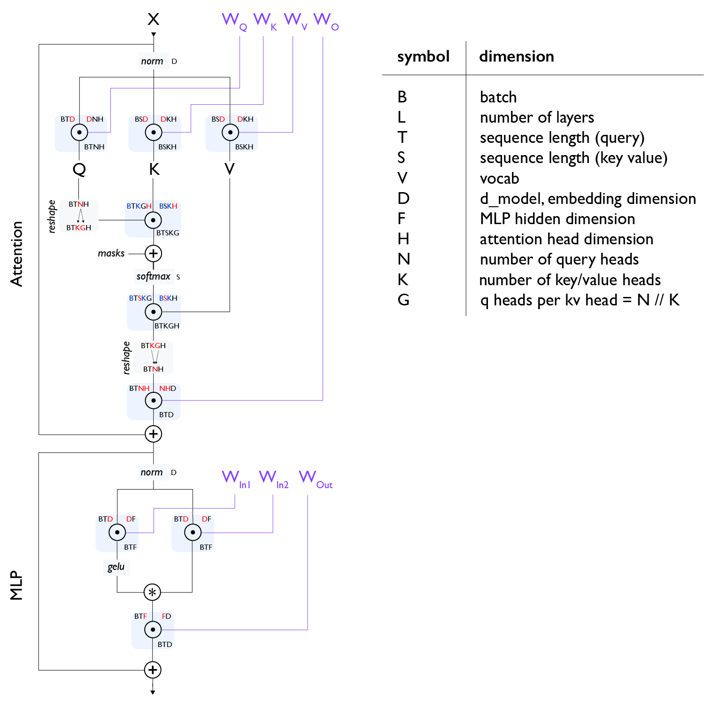

# Transformer Mathematics

## Review
$$\def \red#1{\textcolor{red}{#1}} \def \green#1{\textcolor{green}{#1}} \def \blue#1{\textcolor{blue}{#1}} \def \purple#1{\textcolor{purple}{#1}} \def \orange#1{\textcolor{orange}{#1}} \def \gray#1{\textcolor{gray}{#1}} \begin{array}{cc} \textrm{array} & \textrm{shape} \\ \hline x & \textrm{[P]} \\ y & \textrm{[P]} \\ A & \textrm{[N P]} \\ B & \textrm{[P M]} \\ \hline \end{array}$$
$$\begin{array}{ccc} \textrm{Operation} & \textrm{FLOPs} & \textrm{Data} \\ \hline x \cdot y & 2P & 2P \\ A x & 2NP & NP + P \\ AB & 2NPM & NP + PM \\ [c_0,...,c_N] \cdot [d_0,...,d_N] & 2 \prod c_i \times \prod_{\substack{d_j \notin \blue{BATCH} \\ d_j \notin \red{CONTRACT}}} d_j & \prod c_i + \prod d_j \\ \hline \end{array}$$

## Training vs Inference FLOPs
- Assume $A$ is input activation, $B$ is one of the weight matrices of a model, and output activation $C = AB$. Total FLOPs of forward pass is $2NPM$.
- Derivatives of $A$ and $B$ are $\frac{\partial L}{\partial B} = \frac{\partial L}{\partial C}\frac{\partial C}{\partial B} = A^T \left(\frac{\partial L}{\partial C}\right)$ and $\frac{\partial L}{\partial A} = \frac{\partial L}{\partial C}\frac{\partial C}{\partial A} = \left(\frac{\partial L}{\partial C}\right) B^T$, both cost $2NPM$. Training FLOPs consist of forward and backward FLOPs, which is $6NPM$. Three times of inference FLOPs.

## Global FLOPs and Params Calculation

The below calculations are for training, divide them by 3 for inference.

### MLP
$$\begin{array}{ccc} \textrm{operation} & \textrm{train FLOPs} & \textrm{params} \\ \hline \\ A[B,T,\red{D}] \cdot W_{in1}[\red{D}, F] & 6BTDF & DF \\[10pt] A[B,T,\red{D}] \cdot W_{in2}[\red{D}, F] & 6BTDF & DF \\[10pt] \sigma\left(A_{in1}\right)[B,T, F] * A_{in2}[B,T, F] & \gray{O(BTF)} \\[10pt] A[B,T,\red{F}] \cdot W_{out}[\red{F}, D] & 6BTDF & DF \\[10pt] \hline \\ & \approx 18BTDF & 3DF \end{array}$$

### Attention
The following numbers are per layer:
$$\begin{array}{ccc} \textrm{operation} & \textrm{train FLOPs} & \textrm{params} \\ \hline \\ A[B,T,\red{D}] \cdot W_{Q}[\red{D}, N, H] & 6BTDNH & DNH \\[10pt] A[B,T,\red{D}] \cdot W_{K}[\red{D}, K, H] & 6BTDKH & DKH \\[10pt] A[B,T,\red{D}] \cdot W_{V}[\red{D}, K, H] & 6BTDKH & DKH \\[10pt] A[B,T,\red{N}, \red{H}] \cdot W_{O}[\red{N}, \red{H}, D] & 6BTDNH & DNH \\[10pt] \hline \\ & 12BTD(N+K)H & 2D(N+K)H \end{array}$$

$$\begin{array}{cc} \textrm{operation} & \textrm{train FLOPs} \\ \hline \\[3pt] Q[\blue{B}, T, \blue{K}, G, \red{H}] \cdot K[\blue{B}, S, \blue{K}, \red{H}] & 6BTSKGH = 6BTSNH \\[3pt] \textrm{softmax}_S \;\; L[B, T, S, K, G] & \gray{O(BTSKG) = O(BTSN)} \\[3pt] S[\blue{B}, T, \red{S}, \blue{K}, G] \cdot V[\blue{B}, \red{S}, \blue{K}, H] & 6BTSKGH = 6BTSNH \\[3pt] \hline \\ & \approx 12BTSNH = 12BT^2NH \\ \end{array}$$

### Other Operations
$$\begin{array}{ccc} \textsf{operation} & \textsf{train FLOPs} & \textsf{params} \\ \hline \\ 2 \times \textrm{layernorm}_D \;\; A[B,T,\red{D}] & \gray{O\left(BTD\right)} & \gray{2D} \\[10pt] A[B,T,\red{D}] \cdot W_{unembed}[\red{D}, V] & 6BTDV & DV \\ \end{array}$$

### Rule of Thumb
- If we neglect the cost of dot-product attention (which is reasonable for shorter-context training) and unembedding, then the total FLOPs across all layers is $\begin{aligned} (18BTDF + 12BTD(N+K)H)L = 6 *BT * (3DF + 2D(N+K)H)L \\ = 6 * \textrm{num tokens} * \textrm{parameter count} \end{aligned}$
- If we do account for dot-product attention above and assume $F = 4D$, $D = NH$, and $N = K$, the ratio of dot-product attention FLOPs to all matmul FLOPs (including the attention projections) is: $$\small{\frac{\textrm{attention FLOPs}}{\textrm{matmul FLOPs}} = \frac{12BT^2NH}{18BTDF + 24BTDNH} = \frac{12BT^2D}{4*18 BTD^2 + 24 BTD^2} = \frac{12BT^2D}{96 BTD^2} = \frac{T}{8D}}$$ It means as the MLP size increases, the attention FLOPs become less critical. Dot-product attention FLOPs only become dominant during training once T>8D. For D ~ 8k, this would be ~64K tokens. For large models, the quadratic cost of attention is not actually a huge obstacle to longer-context training. However, for smaller models, e.g. Gemma-27B with D=4608, attention becomes dominant around 37k sequence lengths.

## MoE
Compared to a dense model, an MoE introduces new comms, primarily two AllToAlls (one before and one after the MoE block) that route tokens to the correct expert and bring them back to their home device.

## Memory Cost
### Gradient Checkpointing
- Storing all activations for compute gradients later is in-feasible. A model with $B \times T = 40M$ per batch, $L = 64$, $D = 8192$ requires $2 \times 20 \times B \times T \times D \times L = 84 TB$ of activations in bfloat16.
- Block remat: only save the input to each layer. This is the most aggressive method we use and only saves 1 checkpoint per layer, meaning we’d only save 4.2TB in the example above. This forces us to repeat essentially all forward pass FLOPs in the backward pass, meaning we increase our FLOPs from $6 \cdot \text{num params} \cdot \text{num tokens}$ $8 \cdot \text{num params} \cdot \text{num tokens}$ to roughly.
- Big matmuls only: Only save the outputs of large matmuls. This avoids recomputing large matmuls during the backward pass, but makes us recompute other activation functions and parts of attention. This reduces the 20 per layer above to closer to 7 per layer

### KV Caching
- Each KV cache is $[2, S, L, K, H]$. For a moderately sized model with 8k context length, 64 layers, and $KH = NH = D = 8192$, this is $8GB$.